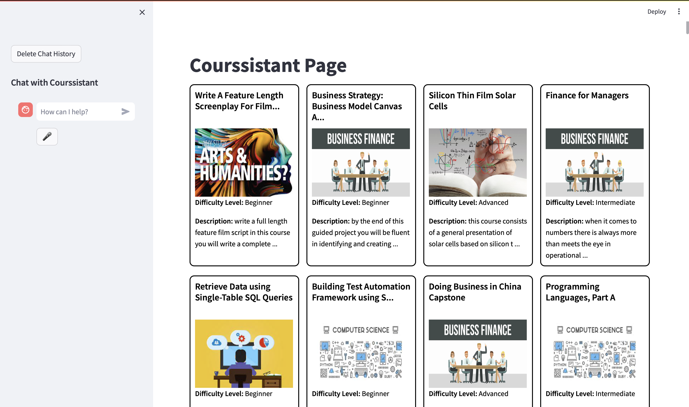
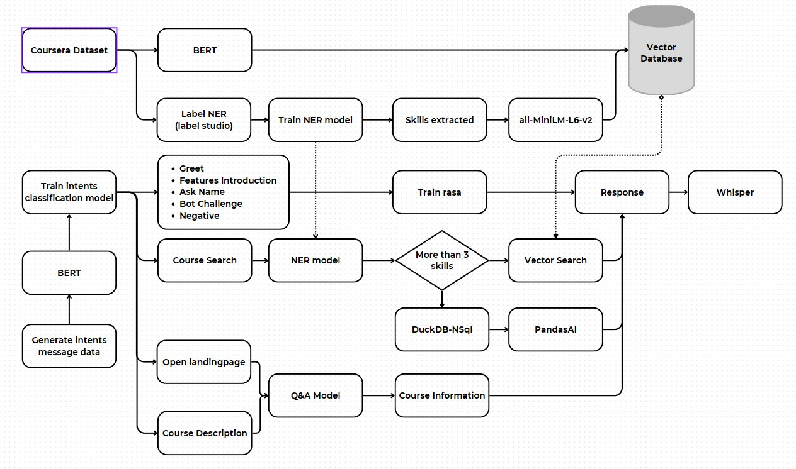
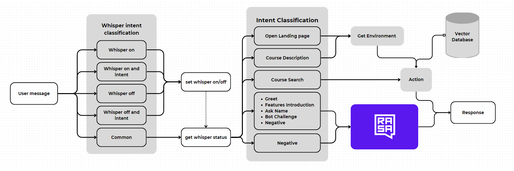

# Courssistant
**Courssistant** (Course - Assistant) is an innovative chatbot designed to support users on an online education platform by initially focusing on essential features. It aims to assist users in navigating the platform effectively, providing foundational support such as course discovery, policy clarification, and basic information retrieval.

Initially, Courssistant will prioritize functionalities like guiding users through course selection based on their preferences and skill levels. It will also handle queries related to platform policies and provide clear explanations on course content.

Future enhancements will include advanced capabilities such as answering assignment queries and explaining formulas through video demonstrations, enriching the user experience with deeper interactive learning support.

By focusing on foundational features first, Courssistant aims to establish a reliable and user-friendly support system that evolves with user needs and advances in educational technology.

# System Requirements:

- XAMPP: 8.0.30
- python: 3.9.19
- [Ollama](!https://www.ollama.com/download)

## Installation

1. Start XAMPP and import `duck_demo.sql` to your MySQL database
2. Download and setup [Ollama](!https://www.ollama.com/download) in your computer
3. Install dependences

```bash
pip install -r requirements.txt
```

## Current Features

- Frequency Question Answering
  - Answer any frequency question 
  - Give information about course
- Advantage Course Search
  - Find course follows skills contain in course that indeed for user
  - Find course using deep understand passengers intents 
- Site interaction : Navigate to any course using voice


## Run

### Solution 1

```bash
rasa run --enable-api --cors "*" --debug
```
On another termial, execute this 
```bash
streamlit run ui/app.py --server.runOnSave true
```

### Solution 2: 🎉 supper easy :>

```bash
python main.py
```


## User Interface

> Homepage

<p align="center">
  
</p>

## Flow

<p align="center">
  
</p>

## System flow

<p align="center">
  
</p>

## Datasets

### Intent Classification Datasets

The dataset can be found at [Kaggle | Intents Dataset for Chatbot](https://www.kaggle.com/datasets/leewanhung/intents-dataset-for-chatbot)
- Whisper on
- Whisper off
- Open landing page
- Course search
- Course description
- Greet
- Feature Introduction
- Ask Name
- Bot Challenges
- Negative

### Coursera Dataset

Dataset of online course on Coursera contain courses information and fake history enrolled course of students, this is an important material to contruct the models

The data can be found on [Kaggle | Coursera Dataset](https://www.kaggle.com/datasets/leewanhung/coursera-dataset)
<!-- 
> LandingPage

> Course Search Features

> Frequency Chat Features


> Open LandingPage using voice
-->

